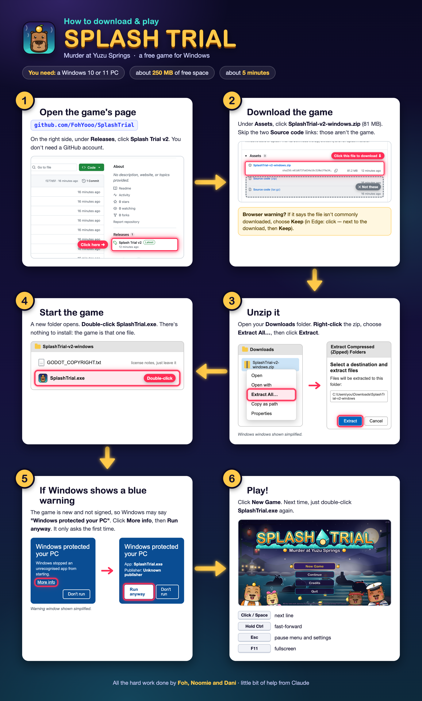

# SPLASH TRIAL (3D version)

> **This branch is the 3D version** (release `v4`), where the game continues. You explore the investigation rooms
> and spend Free Time by **walking around in 3D**, through lobbies, hallways, staircases, gardens and lifts.
> The classic 2D version (release **v3**, branch `main`) is still there and unchanged, but it has Cases 1 and 2 only.

An original capybara murder-mystery trial game. Fifteen capybaras are trapped in a luxury hot-spring resort by
**Warden Snapjaw**. Hang out with your fellow guests, survive the night, investigate a murder,
and convince everyone of the truth at the **Splash Trial**, or you'll all pay the price.

- **Chapter 1: Murder at Yuzu Springs**
- **Chapter 2: Murder on the Mudlark** (new in v3; it follows straight on from Chapter 1.)
- **Chapter 3: Murder at Warden's Rest** (new in v4; a new location and the longest case yet, about 4 hours.
  It has a Logbook you can open at any time with **L**, an Alibi Board and new kinds of trial challenge.
  Its executions are more graphic than in Cases 1 and 2.)

**Choose Case** on the title screen lets you start at any case. Each case opens with the ending of the one before,
so play them in order if you want to solve them yourself.

**All the hard work done by Foh, Noomie and Dani, little bit of help from Claude.**

## How to download and play (Windows)
1. Go to the [latest release](https://github.com/FohYooo/SplashTrial/releases/latest) and download
   **`SplashTrial-3D-windows.zip`** (for the classic 2D game, use the
   [v3 release](https://github.com/FohYooo/SplashTrial/releases/tag/v3) instead; the guide picture below shows
   an older file name, but the steps are the same). The "Source code" links are not the game.
2. Right-click the zip, choose **Extract All…**, then **Extract**.
3. Double-click **`SplashTrial3D.exe`**. There's nothing to install. If Windows says *"Windows protected your PC"*, click
   **More info → Run anyway**. It only asks the first time.

The 3D version keeps its own save, so it never overwrites your 2D save.

The zip also holds `GODOT_COPYRIGHT.txt`, the engine's open-source license notices. Just leave it next to the exe.

## Controls
| Action | Input |
|---|---|
| Walk (investigation rooms, Free Time) | WASD or the arrow keys (Shift to hurry) |
| Look around | Mouse |
| Examine / talk / open a door / press a lift button / hang out | Look at it (the crosshair lights up) and press E, Space or left click |
| Advance dialogue | Left click / Space / Enter |
| Fast-forward dialogue | Hold Ctrl |
| Pause menu (Truth Drops, Skills, Settings) | Esc |
| Fullscreen | F11 or Alt+Enter |
| Investigation map / notebook | M / N |
| Splash Debate: pick a Truth Drop | 1-4 or click; then click a glowing weak spot to fire |
| Rebuttal Showdown: counter | Space or click when the ring hits the target |

## How the trial works
Your **Convince Meter** rises when you argue well and drops with every mistake. At the vote you must
point out the culprit **and** have at least **60%** convince. Otherwise the others ignore you and vote with their gut.
Skills learned during Free Time make the trial easier.

## For developers
- Godot **4.7.2**, GDScript. This 3D branch uses the **Forward+** renderer (falls back to OpenGL if Vulkan/D3D12 is
  missing); `main` (2D) uses GL Compatibility. Open the folder in Godot or run
  `Godot --path . ` (add `-- --autotest` to auto-play the whole game).
- 3D version: `scripts/world3d/` (building kit, player, HUD, the rooms of both chapters) and the two 3D screens
  `scripts/screens/investigation3d_screen.gd` / `freetime3d_screen.gd`. See `docs/ARCHITECTURE.md` §1d.
  Check the walkable spaces with `Godot --headless --path . -s tools/walktest.gd`.
  Add `-- --2d` to get the classic 2D investigation / Free Time screens back.
- Design bibles (spoilers!): `docs/DESIGN.md` (Chapter 1), `docs/DESIGN2.md` (Chapter 2), `docs/DESIGN3.md` (Chapter 3). Engine contracts and the
  chapter system: `docs/ARCHITECTURE.md`. Add `--chapter=2` to any debug flag to work on Chapter 2.
- Art (`art/`) is generated SVG and audio (`audio/`) is generated WAV, both loaded at runtime. Generators live in `tools/`.
- Export: `python3 tools/prepare_export.py`, then
  `Godot --headless --path . --export-release "Windows Desktop" build/3d/SplashTrial3D.exe`, then
  `Godot --headless --script tools/gen_licenses.gd -- out=build/3d/GODOT_COPYRIGHT.txt` and zip both files together.
  The credits also show the Godot MIT license and the FreeType / Mbed TLS / ENet notices.
